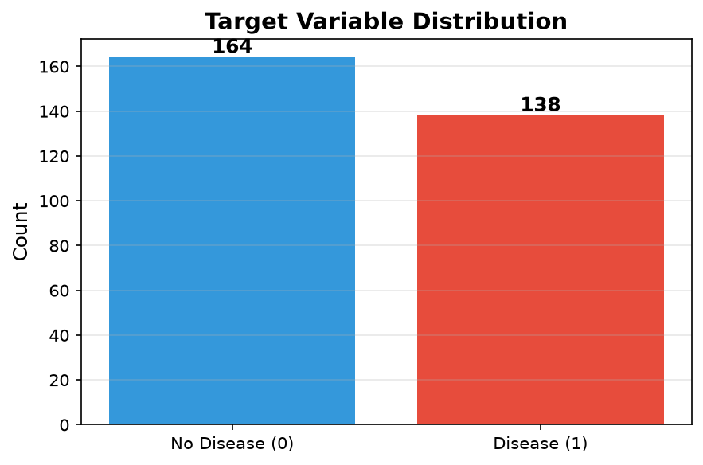
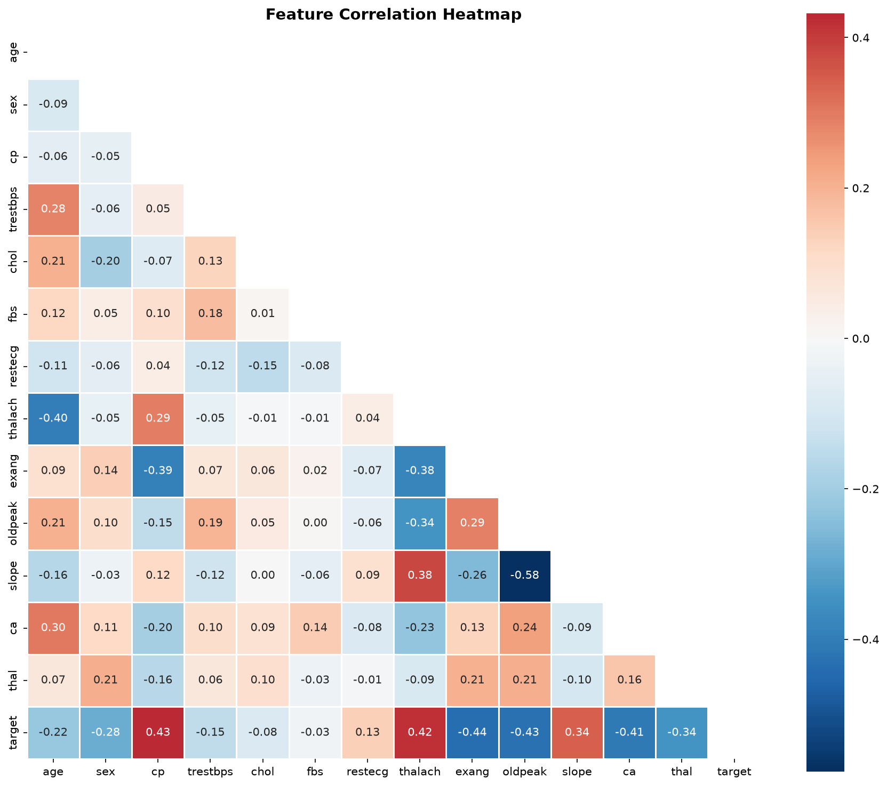

# Heart Disease Risk Predictor — Project Report

## 1. Introduction

Heart disease is one of the leading causes of death globally. Early identification of individuals at risk can enable timely intervention and significantly improve patient outcomes. This project uses machine learning to predict whether a patient has heart disease based on 13 clinical features.

We train and compare six supervised classification algorithms — Logistic Regression, Gaussian Naive Bayes, Decision Tree, Random Forest, Support Vector Machine (SVM), and K-Nearest Neighbors (KNN) — using the UCI Heart Disease (Cleveland) dataset. The best-performing model is deployed as an interactive Streamlit web application for live predictions.

---

## 2. Dataset & Exploratory Data Analysis

### 2.1 Dataset Description

The dataset contains **303 patient records** from the Cleveland Heart Disease database (UCI Machine Learning Repository). Each record has **13 features** and a **binary target** (0 = no disease, 1 = disease).

| Feature | Description | Type |
|---------|-------------|------|
| age | Age in years | Numeric |
| sex | Sex (1 = male, 0 = female) | Categorical |
| cp | Chest pain type (0–3) | Categorical |
| trestbps | Resting blood pressure (mm Hg) | Numeric |
| chol | Serum cholesterol (mg/dl) | Numeric |
| fbs | Fasting blood sugar > 120 mg/dl | Categorical |
| restecg | Resting ECG results (0–2) | Categorical |
| thalach | Maximum heart rate achieved | Numeric |
| exang | Exercise-induced angina (0/1) | Categorical |
| oldpeak | ST depression induced by exercise | Numeric |
| slope | Slope of peak exercise ST segment (0–2) | Categorical |
| ca | Number of major vessels colored (0–3) | Categorical |
| thal | Thalassemia result (0–3) | Categorical |

### 2.2 Data Quality

- **No missing values** — all 303 rows × 14 columns are complete.
- **1 duplicate row** was found and removed, leaving 302 unique records.
- All columns are stored as integers/floats; 8 of the 13 features are actually categorical and were treated accordingly during preprocessing.

### 2.3 Key EDA Insights

1. **Roughly balanced classes**: 165 patients with disease (54%) vs. 138 without (46%). This balance means oversampling techniques like SMOTE are unnecessary, but we still use stratified splitting to preserve the ratio.

2. **Strongest predictors of heart disease**: `cp` (chest pain type), `thalach` (max heart rate), `exang` (exercise-induced angina), `oldpeak` (ST depression), and `slope` show the highest absolute correlation with the target variable.

3. **Max heart rate (`thalach`)** is notably higher in patients with heart disease, while `oldpeak` is higher in patients without disease — both are strong discriminating features.

4. **Outliers exist** in cholesterol (values > 400 mg/dl) and resting blood pressure (> 170 mm Hg). We retained them because they represent clinically plausible values, and the dataset is already small (removing them would reduce statistical power).

5. **Low multicollinearity**: Most features have weak inter-correlations (|r| < 0.5), suggesting each feature contributes unique information to the model.

---

## 3. Methodology

### 3.1 Preprocessing

We used a scikit-learn `ColumnTransformer` inside a `Pipeline` to prevent data leakage:

- **Numeric features** (age, trestbps, chol, thalach, oldpeak): `StandardScaler` to normalize to mean=0, std=1. This is essential for distance-based models like SVM and KNN.
- **Categorical features** (sex, cp, fbs, restecg, exang, slope, ca, thal): `OneHotEncoder(handle_unknown="ignore")`. Although stored as integers, these represent unordered categories (e.g., chest pain type 3 ≠ "three times" type 1).

The pipeline ensures that scaling parameters and category mappings are **fitted only on training data** and then applied to test data, preventing information leakage.

### 3.2 Data Split

- **80/20 stratified split** (random_state=42)
- Training: 242 samples, Test: 61 samples
- Stratification preserves the ~54/46% class ratio in both sets.

### 3.3 Models & Hyperparameter Tuning

Each model was wrapped inside its own preprocessing pipeline and tuned using **GridSearchCV with 5-fold StratifiedKFold** cross-validation on the training set only. The scoring metric was **F1-score**, chosen because both precision and recall matter in medical screening.

| Model | Hyperparameter Grid |
|-------|-------------------|
| Logistic Regression | C ∈ {0.01, 0.1, 1, 10} |
| Naive Bayes | var_smoothing ∈ {1e-9, 1e-8, 1e-7} |
| Decision Tree | max_depth ∈ {3, 5, 7, None}, min_samples_split ∈ {2, 5, 10} |
| Random Forest | n_estimators ∈ {100, 200}, max_depth ∈ {5, 10, None} |
| SVM (RBF) | C ∈ {0.1, 1, 10}, gamma ∈ {"scale", 0.01, 0.1} |
| KNN | n_neighbors ∈ {3, 5, 7, 9, 11} |

---

## 4. Results

### 4.1 Model Comparison (Test Set)

| Model | Accuracy | Precision | Recall | F1-Score | ROC-AUC | CV Accuracy |
|-------|----------|-----------|--------|----------|---------|-------------|
| **Logistic Regression** | **0.869** | **0.838** | **0.939** | **0.886** | **0.905** | 0.826 ± 0.067 |
| SVM | 0.820 | 0.789 | 0.909 | 0.845 | 0.891 | 0.826 ± 0.073 |
| Random Forest | 0.787 | 0.750 | 0.909 | 0.822 | 0.918 | 0.814 ± 0.080 |
| KNN | 0.770 | 0.757 | 0.848 | 0.800 | 0.869 | 0.839 ± 0.036 |
| Decision Tree | 0.738 | 0.718 | 0.848 | 0.778 | 0.774 | 0.768 ± 0.072 |
| Naive Bayes | 0.738 | 0.840 | 0.636 | 0.724 | 0.874 | 0.768 ± 0.076 |

### 4.2 Why Recall Matters More Than Accuracy

In a **medical screening** context, a **false negative** (predicting "no disease" for a patient who actually has heart disease) is far more dangerous than a false positive. A false positive leads to additional tests; a false negative means the patient goes home untreated, potentially leading to a heart attack.

Therefore, **recall** (the ability to catch all true disease cases) is the most critical metric. Among our models, Logistic Regression, SVM, and Random Forest all achieve 90.9%+ recall, while Naive Bayes has the lowest recall at 63.6% — it misses a third of disease cases, making it unsuitable for this application despite having the highest precision.

### 4.3 Best Model: Logistic Regression

**Selected model**: Logistic Regression with C=0.1

**Justification**:
- **Highest test F1-score (0.886)**, indicating the best balance of precision and recall on unseen data.
- **Excellent recall (93.9%)**: it correctly identifies 31 out of 33 disease cases, missing only 2.
- **Strong ROC-AUC (0.905)**: good discrimination ability across all thresholds.
- **Stable cross-validation** (CV accuracy: 0.826 ± 0.067): consistent performance across folds.
- **Highly interpretable**: model coefficients directly show which features increase or decrease disease risk, making it easy to explain to doctors and patients.
- **Fast training** and **simple to deploy**: no complex tree structures or distance computations at inference time.

While KNN had slightly higher CV F1 (0.853 vs 0.842), its test F1 was notably lower (0.800), suggesting it overfit to the training distribution. Logistic Regression generalizes better and is easier to explain in a clinical context.

---

## 5. Discussion

### 5.1 Strengths
- All preprocessing inside scikit-learn pipelines ensures no data leakage.
- Stratified cross-validation provides robust model comparison.
- Six diverse models cover linear, probabilistic, tree-based, ensemble, kernel, and instance-based approaches.

### 5.2 Limitations
1. **Small dataset** (303 samples): Results may not generalize to larger, more diverse populations.
2. **Dataset age**: The Cleveland dataset is from 1988; modern diagnostic features (e.g., troponin levels, BNP) are not included.
3. **Single-site data**: Only Cleveland Clinic patients are represented, introducing potential population bias.
4. **No feature engineering**: We used raw features; domain-specific derived features could improve performance.
5. **Binary classification**: The original dataset had 5 classes (0–4); we collapsed them to binary, losing nuance about disease severity.

### 5.3 Future Work
- Use larger, modern datasets (MIMIC-III, UK Biobank).
- Try ensemble methods like XGBoost, LightGBM, or stacking.
- Add explainability with SHAP values.
- Build a more sophisticated Streamlit dashboard with patient history tracking.

---

## 6. Conclusion

We successfully trained and compared six machine learning models for heart disease prediction. **Logistic Regression** emerged as the best model with a test F1-score of 0.886 and recall of 93.9%, making it both accurate and clinically safe (minimizing missed diagnoses). The model is deployed as an interactive Streamlit web application that takes patient measurements and returns a risk prediction with probability.

This project demonstrates the complete ML workflow: data exploration, preprocessing with leakage prevention, model training with cross-validated hyperparameter tuning, rigorous evaluation, and deployment.
